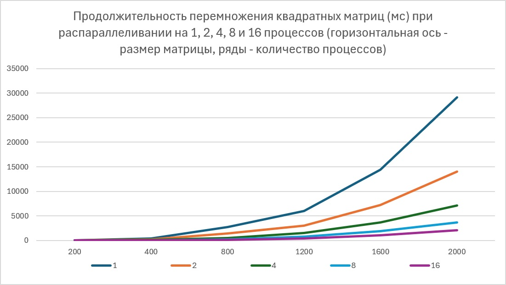
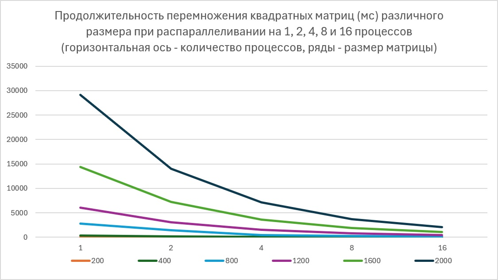

# Lab3
Лабораторная работа №3

## Цель работы

Модифицировать программу из л/р №1 для параллельной работы по технологии MPI.
Провести серию экспериментов с разными размерами матриц (200, 400, 800, 1200, 1600, 2000) и числом процессов (1, 2, 4, 8, 16), запустив параллельную версию на суперкомпьютере «Сергей Королёв».

## Порядок выполнения л/р:
1. Модифицирована программа из л/р №1 и л/р №2 для параллельной работы по технологии MPI:
Строки матрицы A распределяются между процессами (`MPI_Scatterv`), матрица B рассылается всем (`MPI_Bcast`), результат собирается на нулевом процессе (`MPI_Gatherv`); время замеряется `MPI_Wtime` и включает все пересылки.
Программа собрана `intel/mpi4` [compile.sh](compile.sh) и запущена через SLURM [startLab3.pbs](startLab3.pbs).
2. Выполнены запуски программы для разных размеров матриц (200, 400, 800, 1200, 1600, 2000), а для каждого из этих размеров - с разным количеством параллельных процессов (1, 2, 4, 8, 16). Для каждого размера матриц сохранены сгенерированные матрицы "MatrixA.csv", "MatrixB.csv", а также результат перемножения для каждого запуска - "MatrixC_X.csv" (X - количество задействованных параллельных процессов 1, 2, 4, 8, 16). Они сохранены в соответствующие каталоги ([200x200](200x200\), [400x400](400x400\), [800x800](800x800\), [1200x1200](1200x1200\), [1600x1600](1600x1600\), [2000x2000](2000x2000\)). Все результаты перемножения проверены при помощи Python-скрипта, созданного в л/р №1 (результат - достоверное совпадение). Продолжительность времени перемножения для каждого размера матрицы и количества задействованных параллельных процессов сохранены в файле Duration.txt.
3. Результаты этих запусков сведены в таблицу (ниже и в [Duration.xlsx](Duration.xlsx)), по которой составлены 2 графика:
- продолжительность перемножения квадратных матриц (мс) при распараллеливании на 1, 2, 4, 8 и 16 процессов (горизонтальная ось - размер матрицы, ряды - количество процессов);
- продолжительность перемножения квадратных матриц (мс) различного размера при распараллеливании на 1, 2, 4, 8 и 16 процессов (горизонтальная ось - количество процессов, ряды - размер матрицы).

## Результаты

T, мс от Количество параллельных процессов

| Размер | 1       | 2       | 4       | 8       | 16      |
|--------|---------|---------|---------|---------|---------|
| 200    | 46,9279 | 23,577  | 12,5341 | 6,63114 | -       |
| 400    | 361,468 | 181,982 | 94,043  | 48,795  | 20,1008 |
| 800    | 2748,22 | 1429,24 | 465,267 | 245,716 | 136,589 |
| 1200   | 6032,63 | 3041,85 | 1544,71 | 813,271 | 449,864 |
| 1600   | 14405,7 | 7192,77 | 3642,88 | 1910,47 | 1054    |
| 2000   | 29142,6 | 14029,9 | 7104,04 | 3705,56 | 2043,29 |

## Графики

Рисунок 1 — Продолжительность перемножения квадратных матриц (мс) при распараллеливании на 1, 2, 4, 8 и 16 процессов

Рисунок 2 — Продолжительность перемножения квадратных матриц (мс) различного размера при распараллеливании на 1, 2, 4, 8 и 16 процессов

## Вывод
Как видно из результирующей таблицы, увеличение количества процессов в 2 раза на матрице любого размера даёт ускорение чуть меньше, чем в 2 раза. Это объясняется затратами на пересылки между процессами.